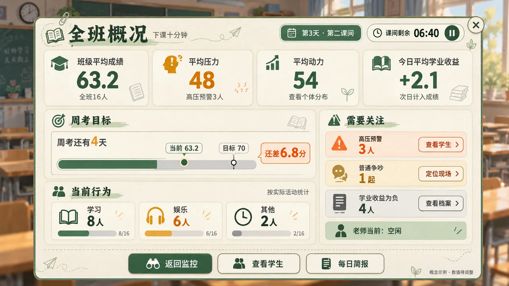

# 全班概况 · 移动端横屏概念图 v01

日期：2026-10-14。状态：根据本轮全班概况讨论生成的界面探索，未接入游戏。
玩法依据：[老师版主策划案](../../../gdd/core-gameplay-v3.1.md)，第 1、4、5、6、11、12 章；新增全班汇总排布属于本次概念建议。
工具：内置 imagegen。完整提示词见 [prompt.txt](prompt.txt)。

## 可以分模块逐步制作

1. 四项平均值：当前平均成绩、平均压力、平均动力、今日平均学业收益。
2. 周考目标：距离首次周考的天数、当前均分、目标与差距。
3. 当前行为：学习、娱乐、其他状态人数，合计 16 人；读取实际活动，不能从平均动力推导。
4. 需要关注：高压预警、普通争吵、今日学业收益为负的学生及定位／档案入口。
5. 时间与老师状态：第几天、当前课间、剩余时间、暂停入口、老师当前是否空闲。
6. 页面导航：返回监控、查看学生、每日简报。

## 数据与设计边界

- 所有平均值以全班 16 名学生为统计对象，办公室中或暂时不能活动的学生也属于班级；老师不作为第十七个统计节点。
- 今日平均学业收益是每名学生当日已经累计的净收益的平均值，保留正负号；不是学习速率、剩余动力或周考成绩预测。
- 平均压力与个体预警同时显示，避免平均值掩盖单个高压学生。
- 行为人数中的“其他”需要实现时列明所含实际状态；图中的 8、6、2 人仅为排版示例。
- 学业收益为负属于学业提醒；普通争吵属于可介入事件，不能直接判为霸凌或辞退。
- 图中均分 63.2、压力 48、动力 54、收益 +2.1、目标 70、差距 6.8、剩余时间和预警人数均为示例，未裁定新的正式参数或风险阈值。
- 图片用于布局和美术讨论，正式 UI 使用独立文字、按钮、卡片及真实数据；不把整张图作为可操作界面底图。

[原图](class_overview_concept_v01.png)

