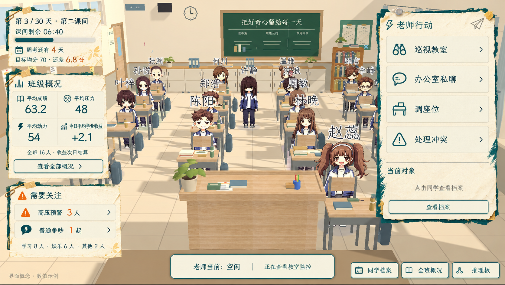
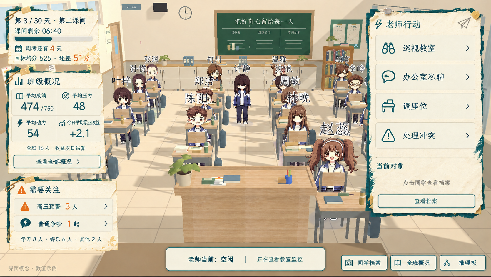

# 教室常驻数据 HUD 概念图 v01

日期：2026-10-14。工具：内置 imagegen。
依据用户提供的现有教室截图编辑，保留场景与纸张卡片风格，展示老师版信息排布。未接入游戏，非运行时验收截图。
玩法依据：[老师版主策划案](../../../gdd/core-gameplay-v3.1.md)。

## v02：高考总分尺度（2026-10-14）

当前成绩尺度先按高考 750 分制绘制：示例当前均分 474/750、目标均分 525、差距 51 分。525 仅为图中示例，不是已确定的首次周考达标线。
压力、动力仍为 0–100；今日平均学业收益 +2.1 表示已经累计的成绩分数变化，不是百分比，不随旧概念图的百分制示例自动乘以 7.5。
工具：内置 imagegen。[本次编辑提示词](prompt-v02-750.txt) · [新版原图](classroom_hud_concept_v02_750.png)

以下 v01 图及其示例保留作为历史布局参考。

## 常驻信息（v01布局参考）

- 左上：日期、当前课间、剩余时间、周考倒计时及目标差距。
- 左侧中部：平均成绩、平均压力、平均动力、今日平均学业收益；提供“查看全部概况”入口。
- 左下：高压预警和普通争吵的简短提醒，以及学习／娱乐／其他实际状态人数。
- 右侧：老师行动与对象档案入口。
- 底部：老师当前状态、同学档案、全班概况和推理板入口。
- 教室保持可见，全班详细概况通过入口另行打开。

## 示例边界

目标 70、当前均分 63.2、平均压力 48、平均动力 54、今日平均收益 +2.1、预警数量与时间均为示例，不确定正式参数或风险阈值。
今日学业收益是累计量，不是即时学习速率；普通争吵不等于霸凌。
此图用于常驻 HUD 布局讨论，没有完成 16 人座位或角色阵容的场景迁移。人物与座位沿用参考截图，旧玩家位置清空作为示意。
正式制作应使用独立 UI 节点和真实数据，不把整张图作为可操作界面底图。

[完整编辑提示词](prompt.txt) · [原图](classroom_hud_concept_v01.png)

