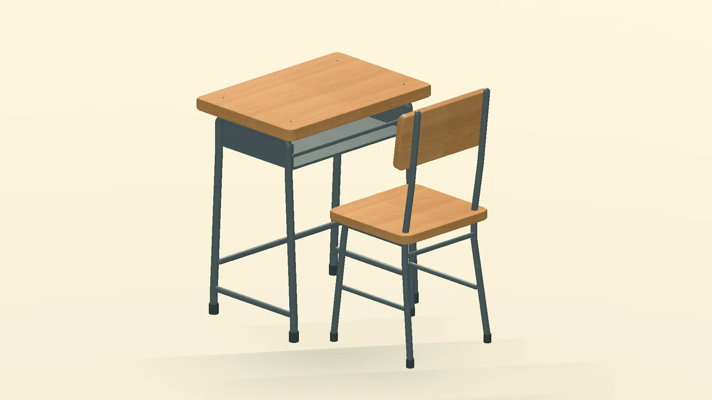

# 中国高中桌椅结构小样 v1

日期：2026-10-12。真实 Godot 4.7.2 / D3D12 Mobile 渲染，不是生成的概念图。



[新旧对照](comparison-20261012.png)：左为小样，右为现有组件。[正面视角](front-20261012.png)。

## 交付

- 独立组件：`scenes/components/school_desk_chair_sample.tscn`。
- 展示场景：`scenes/game/school_desk_sample_showroom.tscn`，可在 Godot 编辑器中打开后按 F6 查看。
- 几何与材质配置：`data/ui/school_desk_sample.json`。
- 重建工具：`tools/build_school_desk_sample.gd`。
- 截图工具：`tools/capture_school_desk_sample.gd`。

小样补充圆角和倒角桌板、层压木材封边、弧形后倾椅背、圆管架、横撑、开放桌斗、螺丝和橡胶脚套。复用原有木板贴图，调整木色与金属质感；所有新几何由代码构建，正式组件已烘焙，无运行时建模脚本。

沿用桌板 0.66 × 0.46 米、椅子原点、`StandSpot`、`SitPoint`、`NavBlocker/Blocker` 的现有接口与占位。没有替换主教室组件，没有改动原材质 `.tres` 或玩法逻辑。

## 验证与后续

GUT 2 项、1880 个断言通过，检查资源可加载、锚点及导航形状相同、网格尺寸有限、面朝向正确，以及展示场景没有重叠实例。新工具格式与静态检查通过；三种视角实际渲染检查完成，最终截图工具运行未出现脚本或资源清理错误。

这是单套桌椅的结构和材质样板。金属仍以共享底色材质为主，未制作手绘磨损贴图；尚未做整班实例化性能标定、人物坐姿对齐与课堂镜头下的尺寸验收。若用于全教室，需要按材质合并／批量实例化小部件，再与人物同框验证。

重建与截图：

```powershell
godot --headless --path . --script tools/build_school_desk_sample.gd
godot --path . --script tools/capture_school_desk_sample.gd
godot --headless --path . -s addons/gut/gut_cmdln.gd -gtest=res://tests/unit/test_school_desk_sample.gd -gexit
```

截图工具输出到 `tools/out/school_desk_sample/`；上方预览已另外保存到本目录。
