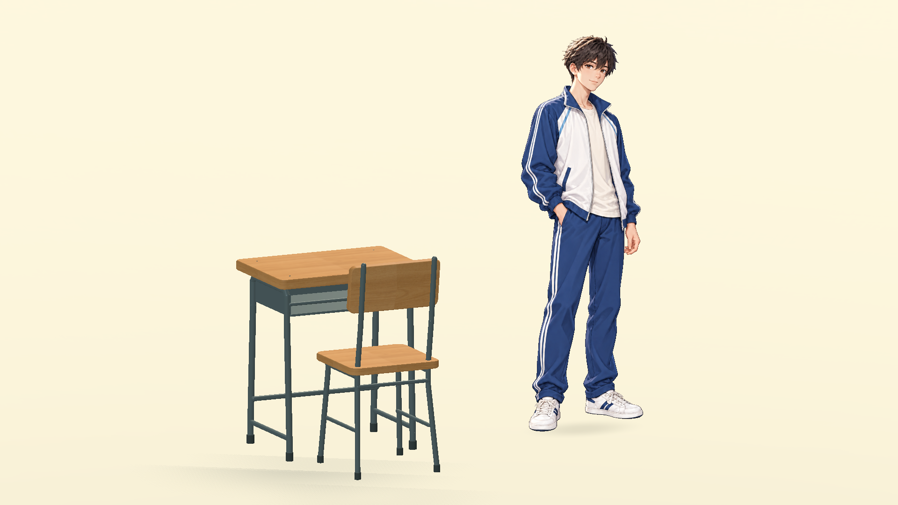

# 高中男生站姿小样 v1

日期：2026-10-12。内置 image_gen 生成并清理透明背景；Godot 4.7.2 / D3D12 Mobile 同框渲染验收。

## 交付

- 原始透明立绘：`source-generated-v1.png`，1024 × 1536，RGBA。
- 游戏贴图：`assets/textures/characters/samples/school_student_male_standing_v1.webp`，无损打包，1011926 字节，低于 1 MiB；尺寸、alpha 和所有 alpha 非零的像素值与生成 PNG 一致。
- 独立人物组件：`scenes/characters/school_student_sample.tscn`。
- 桌椅同框展示：`scenes/game/school_student_sample_showroom.tscn`，在 Godot 中打开后按 F6。
- 配置：`data/ui/school_student_sample.json`。
- 重建／截图工具：`tools/build_school_student_sample.gd`。

人物为精细 2D 立绘，以 Sprite3D 进入 3D 空间，绕 Y 轴面向相机；使用线性 mipmap 过滤与 alpha 剔除。AtlasTexture 仅选择实际人物区域，不改写源图片。按 1.65 米身高校准，与 0.74 米课桌比较；脚底接触阴影由场景绘制。

本版用于验证站姿外观、比例和家具搭配，不含骨骼、行走帧、坐姿或朝向变体，没有替换现有角色或接入人物决策。透视、脚部和坐姿衔接仍需在后续动作样板中继续校准。

## 验证

PNG / WebP 尺寸与 alpha 一致、所有可见像素无损；四角透明。Godot 正式场景与贴图成功加载，默认渲染器同框截图已人工检查，截图保存成功且最终工具运行无脚本错误或资源清理错误。工具格式和静态检查通过。

## 生成提示词

Use case: stylized-concept.
Generate ONE production-oriented character art sample for a Chinese high school social simulation game. A SINGLE full-body Chinese teenage boy, age about 16–17, in an ordinary blue-and-white Chinese high school tracksuit. The output is a usable TRANSPARENT-background standing character sprite, not a character sheet, not a portrait or scene.
Style: refined hand-painted 2D anime illustration suitable for a polished 2.5D classroom game. Precise clean linework, delicate painterly cel shading, convincing folds and grounded proportions. Match a softly lit illustrated Chinese classroom with honey-brown wood desks and sage-green walls. Not pixel art, not chibi, not photorealistic, not a plastic 3D render. Approximately 6–6.5 heads tall; moderate stylization, naturally sized eyes and head. Fine detail must remain legible when scaled down.
Character: gently tousled short dark-brown hair, natural warm skin, calm friendly face, no glasses, no school logos or badges with text. White/off-white track jacket with navy-blue shoulder panels and sleeves, thin pale blue piping, slightly open collar over a simple cream T-shirt. Matching navy track pants with white side stripes, white low-top sneakers with small navy details. Slightly worn everyday school clothes, not fashion styling.
Pose: relaxed neutral standing, BOTH feet fully visible and planted at the same ground level, slight three-quarter turn toward viewer's left, face visible in three-quarter view. Arms naturally relaxed, hands visible, no props or backpack, no exaggerated gesture. Camera close to horizontal with only a gentle downward view, avoiding top-down distortion. Weight balanced, knees straight but relaxed, believable hands and footwear. Entire silhouette including hair and shoe soles completely within frame, narrow consistent margins. Center the single person, fill most of a vertical 2:3 image.
Lighting: very gentle warm window light from upper left, soft cool fill, subtle clean shadows in fabric folds. No strong rim glow, no harsh directional shadows, no ground shadow embedded in image.
Constraints: genuinely transparent alpha background, no white rectangle, no scenery, no floor, no cast ground shadow, no text, no labels, no frame, no watermark, no extra people, no duplicate limbs. This is a STANDING appearance sample, not an animation or seated pose.

### 透明背景整理

Use case: background-extraction. Edit this character image ONLY to extract the boy onto genuine complete transparency. Remove ALL backdrop, ALL soft glow and haze around and behind his body and shoes, every vignette and every cast shadow. Outside the exact character silhouette every pixel must have alpha zero, including between the legs, beside the hair, and below and around the shoes. Preserve the same boy, face, hairstyle, pose, full-body proportions, blue-white tracksuit, linework, existing colors and the complete footwear unchanged. Add a small transparent margin above the hair to avoid touching the canvas edge. No replacement background, no floor, no glow, no shadow. Output a clean isolated game sprite with precise anti-aliased silhouette boundaries and transparent alpha.

