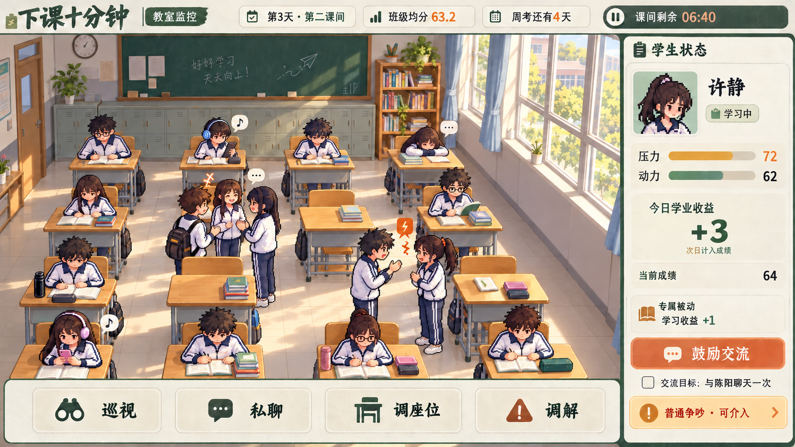

# 老师版移动端主界面概念图 v01

日期：2026-10-14。依据：[当前老师版策划案](../../../gdd/core-gameplay-v3.1.md)，重点参考第 1、4、6、7、11、12 章。
状态：美术与界面探索，使用内置 imagegen 生成，未接入 Godot，非运行截图。

## 画面内容

- 移动端横屏，教室监控占主要区域，右侧学生状态面板，下方大尺寸老师操作入口。
- 16 名学生，目标座位布局为 4×4；老师通过监控观察，不作为第十七名学生出现在教室。
- 延续暖木色 3D 教室与像素人物，靠实际学习、聊天、娱乐、休息和普通争吵表现班级状态。
- 压力、动力分别使用独立数值条；今日学业收益使用有符号累计值，并注明次日计入成绩；当前成绩单独显示。
- 展示公开专属被动、鼓励交流及一次待完成的指定聊天目标；鼓励没有直接增加好感。
- 老师操作包含巡视、私聊、调座位、调解。普通争吵提供介入入口，没有直接标记为霸凌；短暂独处没有直接标记为孤立。
- 顶部展示日期、课间、班级均分、首次周考倒计时和课间剩余时间。

## 示例与实现边界

图中的第 3 天、均分 63.2、压力 72、动力 62、收益 +3、成绩 64、剩余时间以及“许静”的被动绑定均为排版示例，不新增正式数值或角色绑定规则。
行为图标、瞬时关系提示和界面排布仅表达美术方向；正式开发使用 Godot 场景、文字节点和真实模拟状态，不把整张图作为可操作界面底图。
风险提示需要对应真实事件与判据；不从单个动作推断持续排斥或霸凌。具体关系信息展示范围仍以策划案后续裁定为准。
本次生成没有修改运行时脚本、场景或数据。

## 生成提示词

工具：内置 imagegen，非 CLI/API 回退。

1. [初始生成提示词](prompt-initial.txt)：依据老师版策划和现有美术方向生成主界面。
2. [人数与座位布局修正提示词](prompt-grid-correction.txt)：保留界面，修正教室布局及人数。
3. [最终局部修正提示词](prompt-final-correction.txt)：补齐前排右侧空座的一名学生，最终图保留 16 名学生。

最终交付：[原图](teacher_mobile_gameplay_concept_v01.png)。未选中的中间图没有加入项目。

