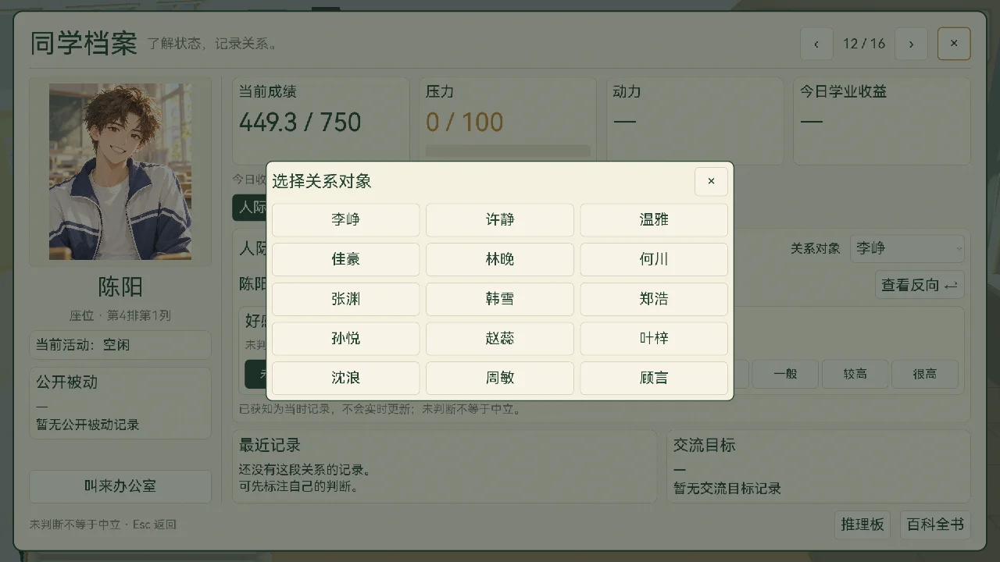

# 老师版同学档案验收 · 2026-10-14

工作目录：`D:/game/下课十分钟-mobile`，分支 `main-mobile`。用户确认概念图后替换现有模板，未修改模拟规则。

## 实际界面

- 四张卡片显示当前成绩、压力、动力、今日学业收益；成绩不提前计入收益，支持有符号净收益。
- 个人当前成绩与按已累计收益的结算预览统一四舍五入显示整数分；班级平均成绩保留小数，平均计算和模拟累计不由档案显示格式改变。
- 身份区保留画像、姓名与真实座位，加入实际活动与公开被动；旧讲桌旁座位按真实座位表显示，不伪造移动到 4×4。
- 关系对象排除自身与旧玩家。好感与敌对独立，双向分开，支持未判断、较低、一般、较高、很高。
- 移动端点击关系对象打开原生同学按钮网格，全部 15 名可选同学在弹层内直接点击；不依赖原生 PopupMenu 的鼠标选择路径。用实际 ScreenTouch 按下／释放验证打开、选择和关闭。
- 标注显示“我的推测”；新真实消息覆盖对应方向与轴并注明获知时间，来源通过该轴提示查看；旧消息不实时刷新，也不重复覆盖后来手动修改的判断。
- 历史与状态页使用原移动端触摸滚动。公开被动、收益明细、趋势、关注事件、干预及目标缺少数据时显示缺失，不推断风险或编造被动。
- 叫来办公室跳转已有办公室学生选择器，并显示原有未接入提示；百科／推理板复用已有导航与暂停交接。

## 数据与保存边界

`update_student_snapshot(index, snapshot)` 接收公开快照，字段为 `grade`、`grade_max`、`pressure`、`motivation`、`academic_gain`、`activity`、`passive`、`communication_goal`、`gain_details`、`trends`、`attention`、`interventions`；兼容未来内核 `teacher_student_snapshot(index)` 只读接口。

当前成绩、压力、活动来自旧运行时，动力与收益不使用旧性格、压力或学习累计代算。结算预览只使用已经累计的收益并处理成绩上界，不保证未来收益。

`NpcProfileData.state` 是独立观察字典，`GameState.profile_notebook` 持有本局内容；切换档案、视图或重建档案不清空。新开局清空笔记；JSON 往返后保留推测与消息去重。主菜单继续游戏原有 TODO 尚未接通，本次不声称实现整局保存或跨启动恢复。推理板手写笔迹继续保留，尚未增加自动多人假说或双人标注联动。

## 验证

- `tests/unit/test_npc_profile.gd`：3 项、20 个断言通过；方向、旧消息去重、逐轴覆盖、清除、JSON 往返、未知状态、只读与暂停边界。
- `tests/unit/test_study_navigation.gd`：3 项、35 个断言通过；六条互通路径、人物保留、外部暂停与黑板输入。
- 全量 unit：411 项中 409 通过，2 项既有老师版教程 pending，零失败。
- 全量 GUT integration：25 项中 20 通过，5 项既有学生版入口 pending，零失败。
- `tests/integration/verify_teacher_profile.gd`：独立引擎回归 PASS，检查真实按钮、反向独立、未知数据、负收益快照、页面切换、本局界面重建、矩阵与完整随机状态不变。
- `tests/integration/test_office_hub.gd`：办公室回归，包含档案到办公室入口、选择器暂停交接和保留原教室实例。
- 隐藏滚动区触摸回归：等待实际布局后复现父档案隐藏仍拦截触摸；滚动组件改为检查 `is_visible_in_tree()` 并重置手势，失败回归转为通过。
- 截图检查 1280×720 与 1920×1080，关系页／状态页、空记录／多条真实接口夹具；夹具不进入正式游戏或存档。
- 快门禁：check_config、test_core、verify_formula、check_docs；格式与静态检查单独执行。

本机可执行引擎为 Godot 4.6.3，低于项目定稿 4.7.2。GUT 9.7.1 加载出现 `AccessibilityServer`、`stub_params.gd` 兼容报错与退出资源提示；独立档案回归不依赖 GUT，行为断言通过，部分运行仍有退出资源提示。本次不替代目标引擎或手机真机验收。

完整离线 `tools/run_tests.sh --no-godot`：7 段通过，3 段失败（`check_metrics`、`diversity_report`、`check_magic_numbers`），1 段跳过。数值扫描的 13 项均位于已有 `exam_settle.gd`、`sim_core.gd`、`observe_behavior.gd`，本次未修改这些内核。旧玩法门不证明老师版迁移完成。

## 截图

